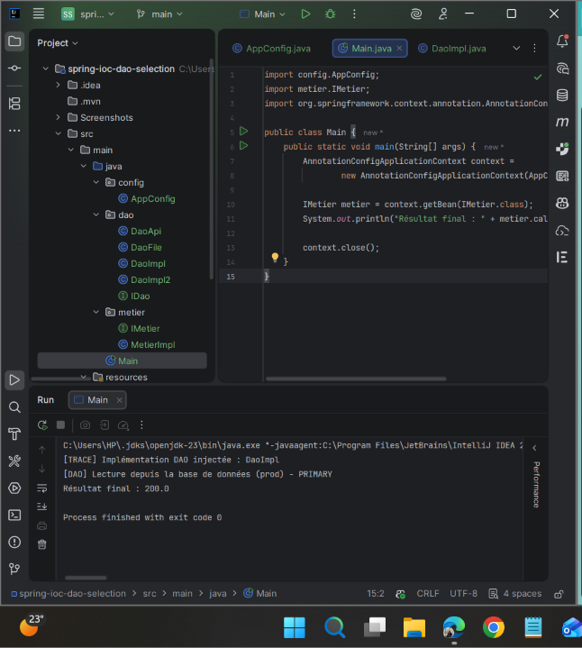
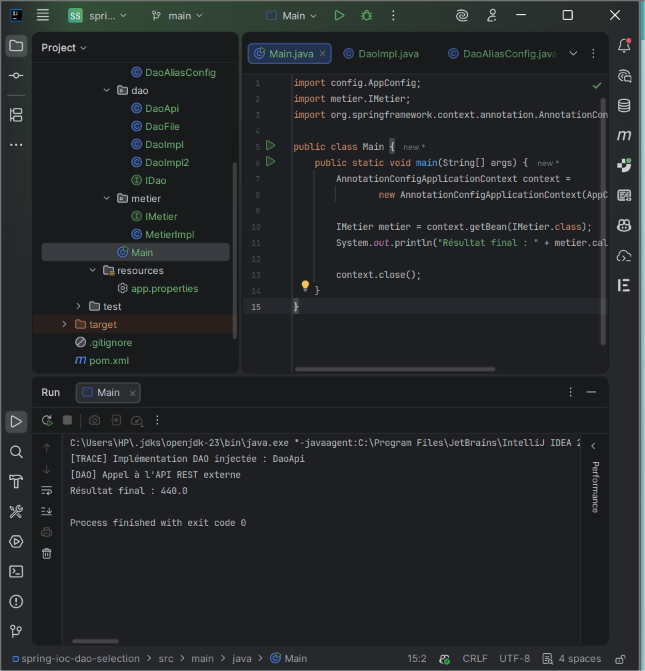
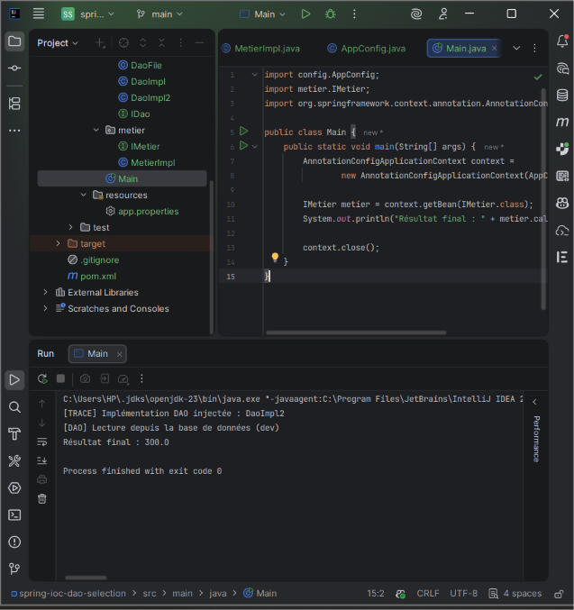
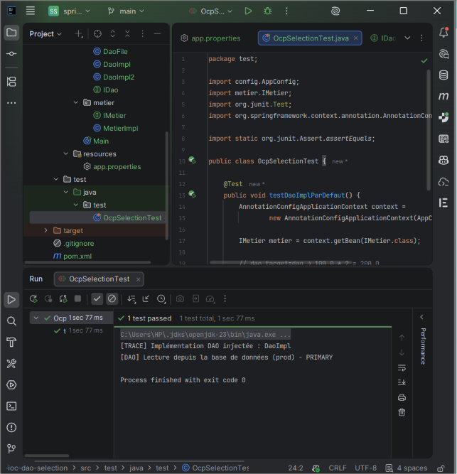
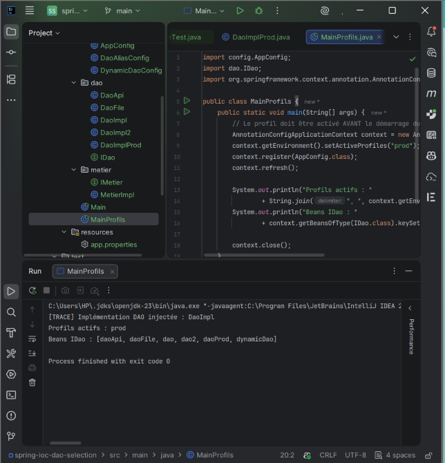
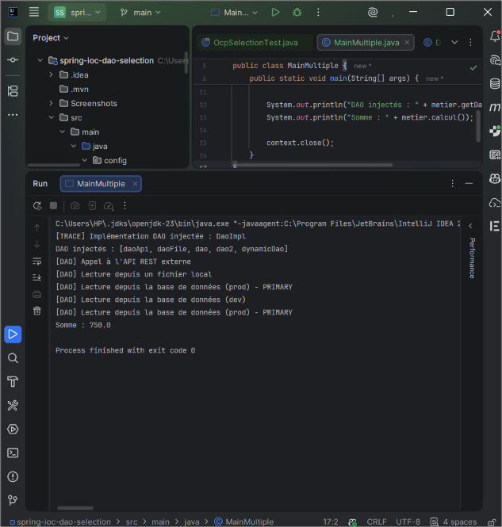

# Spring IoC – Sélection de l'implémentation DAO (principe OCP)

Lab réalisé par **Hibatalah Hamrani** – EMSI Marrakech, cycle ingénieur DSI  
Module : Frameworks et architecture microservice

## Objectif
Montrer comment Spring choisit quelle implémentation de `IDao` injecter dans `MetierImpl`,
**sans jamais modifier le code métier** (principe Ouvert/Fermé – OCP).

## Technologies
- Java 17
- Maven
- Spring Context 5.3.30
- JUnit 4

## Structure du projet
```
src/main/java
├── config/
│   ├── AppConfig.java
│   ├── DaoAliasConfig.java
│   └── DynamicDaoConfig.java
├── dao/
│   ├── IDao.java
│   ├── DaoImpl.java
│   ├── DaoImpl2.java
│   ├── DaoFile.java
│   ├── DaoApi.java
│   └── DaoImplProd.java
├── metier/
│   ├── IMetier.java
│   ├── MetierImpl.java
│   └── MetierMultiple.java
├── Main.java
├── MainProfils.java
└── MainMultiple.java
src/main/resources/app.properties
src/test/java/test/OcpSelectionTest.java
```

## Le problème : l'ambiguïté
Quatre beans implémentent `IDao` (`dao`, `dao2`, `daoFile`, `daoApi`).
Spring ne sait pas lequel injecter et lève `NoUniqueBeanDefinitionException`.

## Stratégie A – @Primary
`@Primary` sur `DaoImpl` indique à Spring le bean à choisir par défaut.  
Résultat : **200.0** (100 × 2)



> Limite : choix statique, il faut modifier le code et recompiler pour changer.

## Stratégie B – Alias via @Bean
Un bean `@Primary` déclaré dans `DaoAliasConfig` pointe vers `DaoApi`.  
Résultat : **440.0** (220 × 2)



> On change de source sans toucher aux classes DAO ni au métier.

## Stratégie C – Fichier de propriétés
La clé `dao.target` dans `app.properties` choisit l'implémentation, **sans recompiler**.

| dao.target | Implémentation | Résultat |
|---|---|---|
| dao2 | DaoImpl2 | 300.0 |
| daoApi | DaoApi | 440.0 |



## Test JUnit
`OcpSelectionTest` vérifie qu'avec `dao.target=dao` le résultat vaut 200.0.
Si on change la configuration, le test échoue : le comportement change sans modifier `MetierImpl`.



## Profils Spring
`DaoImplProd` n'existe que si le profil `prod` est actif.
Le profil doit être activé **avant** le démarrage du conteneur :

```java
AnnotationConfigApplicationContext context = new AnnotationConfigApplicationContext();
context.getEnvironment().setActiveProfiles("prod");
context.register(AppConfig.class);
context.refresh();
```



## Injection multiple
`MetierMultiple` reçoit tous les beans `IDao` dans une `List` et une `Map`.  
Somme : **750.0** (100 + 150 + 180 + 220 + 100 pour `dynamicDao`)



## Remarques et corrections par rapport à l'énoncé
- **Une seule stratégie `@Primary` active à la fois** : sinon Spring trouve plusieurs beans primaires et plante.
- **Résolution par nom de paramètre** : avec `MetierImpl(IDao dao)`, Spring injecte le bean nommé `dao` sans erreur. Le paramètre a été renommé `idao` pour faire apparaître l'ambiguïté.
- **`config` ajouté au `@ComponentScan`** : sinon `DaoAliasConfig` et `DynamicDaoConfig` ne sont jamais chargées.
- **Profils** : `setActiveProfiles()` appelé après `new AnnotationConfigApplicationContext(AppConfig.class)` n'a aucun effet, car le conteneur est déjà démarré.
- **`MetierMultiple`** crée un deuxième bean `IMetier` : le bean métier est donc récupéré par son nom (`getBean("metierImpl", IMetier.class)`).
- **Dépendance `javax.annotation-api`** ajoutée pour `@PostConstruct` (absente du JDK depuis Java 11).

## Comparaison des stratégies
| Stratégie | Flexibilité | Recompilation nécessaire |
|---|---|---|
| @Primary | Faible | Oui |
| Alias @Bean | Moyenne | Oui |
| Propriétés externes | Forte | Non |
| Profils | Par environnement | Non |

## Conclusion
Grâce à l'IoC de Spring, `MetierImpl` dépend uniquement de l'interface `IDao`.
On peut changer la source de données (base, fichier, API) par configuration,
sans jamais modifier le code métier : c'est le principe Ouvert/Fermé.